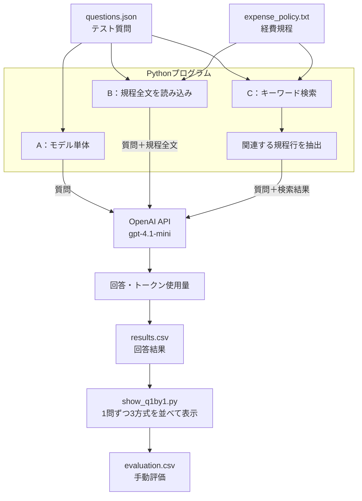

# アーキテクチャ図 — 社内FAQ AI

## 全体構成

## 処理の説明

### A：モデル単体

テスト質問をOpenAI APIに送り、回答を生成する。社内規程は渡さず（一般知識で断定しないよう指示を付ける）、モデル単体での回答を比較する。

### B：規程全文

経費規程の全文を読み込み、質問と一緒にOpenAI APIに送る。規程をコンテキストとして与えた場合の回答品質を確認する。

### C：簡易RAG

Pythonで経費規程を検索し、関連する規程行を抽出する。質問と検索結果をOpenAI APIに送り、必要な情報を絞った場合の回答品質を確認する。

### 結果の記録と評価

各方式の回答とトークン使用量の出力テキストを、Pythonでマージして `results.csv` にまとめる。`show_q1by1.py` で、質問ごとに3方式の回答を並べて表示し、その後、期待回答との一致、規程への忠実さ、適切な回答保留などを手動で評価し、`evaluation.csv` に記録する。

## 設計上のポイント

- Pythonはファイルの読み込み、検索、繰り返し処理などを担当する。
- OpenAI APIは質問と与えられた情報に基づく自然言語の回答生成を担当する。
- 規程全文を渡す方式と、関連箇所を検索して渡す方式を比較できる構成にする。
- 回答生成と回答品質の評価を分け、結果に基づいて改善できるようにする。

本構成は、検証用の架空データを用いたプロトタイプである。実運用では、アクセス制御、データ保護、規程の更新、検索品質、回答の検証なども検討する必要がある。
